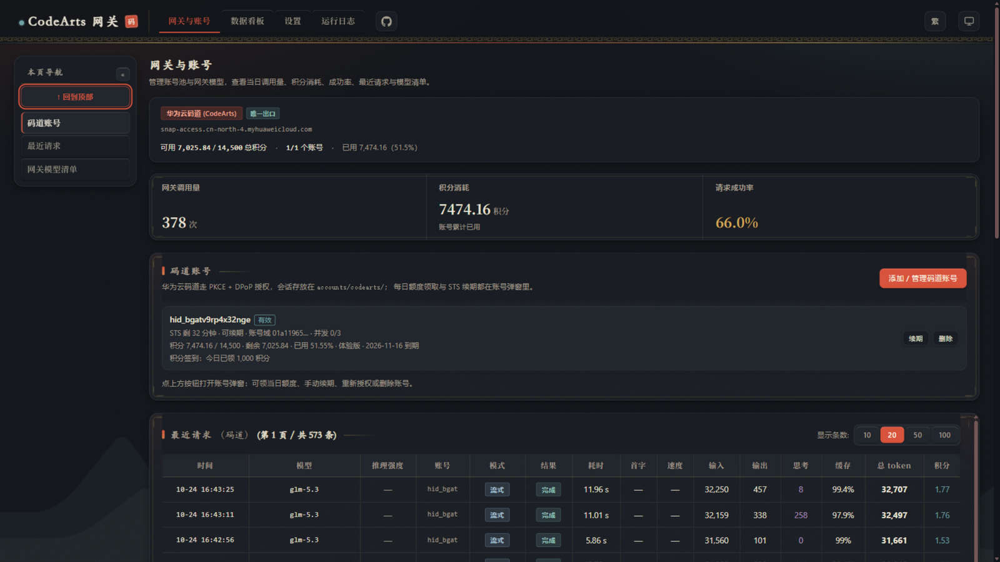
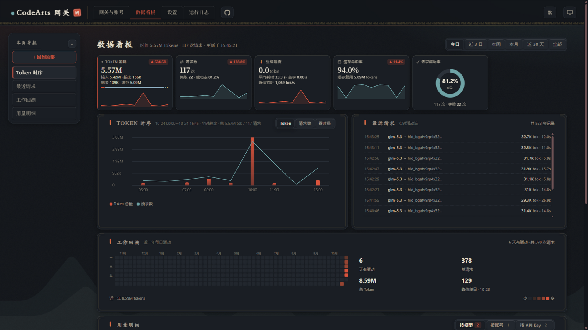
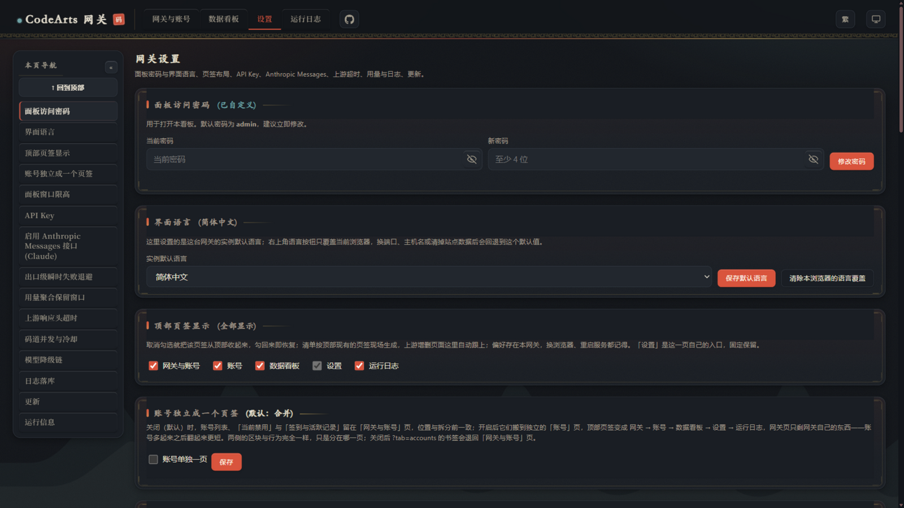
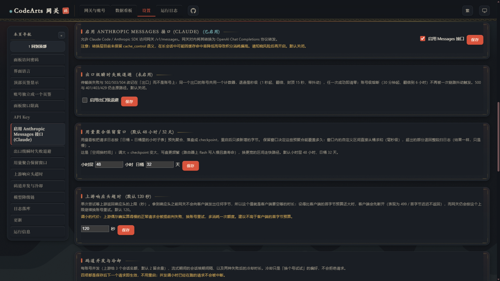

# CodeArts Agent 2API Hub — 码道模型网关

把**华为云码道（CodeArts）**的推理能力封装成标准 API：**OpenAI Chat Completions / Responses / Anthropic Messages** 三种协议，自带账号管理、每日签到、Web 看板与用量统计。

<p align="center">
  <a href="https://github.com/yorushikasama/codeArtsAgent-2api-hub">
    
  </a>
</p>

- **开箱即用**：纯 Python 标准库，零第三方依赖；`start-codearts-hub.bat` / `.command` / `.sh` 双击即启；
- **单一上游**：只对接华为云码道（`snap-access.cn-north-4.myhuaweicloud.com`），账号、限额与用量都按这一个出口记账；
- **三种协议**：`/v1/chat/completions`、`/v1/responses`（Codex）、`/v1/messages`（Claude Code / Anthropic SDK，面板开关，默认关闭）；
- **实测模型清单**：`/v1/models` 只列**实测可推理**的模型（当前 11 个），带上下文窗口、最大输出、思考档位与视觉能力宣告，不拿服务端目录凑数；
- **官方客户端对齐**：出站头族、思考档位白名单、逐模型 `max_tokens`、`tool_stream` 与服务器排队协议均按官方客户端逆向对齐——断流、拒答与 `APIG.0203` 显著减少；
- **韧性栈**：建连预算 → 退避重试 → flow-control 分流 → 模型健康熔断 → 可配置降级链 → 大上下文 history-snip 软剪枝；
- **账号接入**：看板点链接走华为云 PKCE + DPoP 授权，浏览器直接回跳本机网关；STS 临时凭证约 2 小时到期，网关自动续期；
- **每日签到**：00:05 自动为所有码道账号签到领积分，账号卡片直接看「今日已领」；
- **Web 看板**：调用量、积分消耗、Token 时序、成功率、工作回溯热力图、请求流水、账号与设置一屏可查。

> ⚡ **Vibe Coding 产物**：本项目为 100% Vibe Coding 协同产物——人类开发者提出架构与业务意图，AI 助手端到端完成逆向分析、链路调度与界面编写。

---

## 一、快速启动

### 1. 本机运行

**Windows** 双击 **`start-codearts-hub.bat`**，保持窗口运行；**macOS** 双击 **`start-codearts-hub.command`**
（首次被 Gatekeeper 拦截时右键 →「打开」确认一次），或在终端执行 `./start-codearts-hub.sh [端口]`（默认 8788）。

启动后：**API 地址** `http://127.0.0.1:8788/v1`，**Web 看板** `http://127.0.0.1:8788/`。
首次启动还没有账号，打开看板点「添加 / 管理码道账号」完成授权即自动入库。

> 绿色包自带的精简 Python 运行时只覆盖 Windows；macOS / Linux 直接使用系统 Python，需要 **3.9+**。

### 2. 面板访问密码

看板需要**面板访问密码**，它与 API Key 相互独立：密码只用于打开看板，可在「设置」页修改
（或启动时 `--panel-password` 指定），以 PBKDF2-SHA256 摘要存于 `accounts/settings.json`（不存明文）。

本机 / 受信局域网自用可带 `?pwd=面板密码` 免手输直接进面板；**公网暴露时不要用**——
密码会留在浏览器历史与反向代理日志里。**首次登录后请立即改掉默认密码。**

### 3. Docker 部署

```yaml
services:
  codearts-hub:
    image: ghcr.io/yorushikasama/codeartsagent-2api-hub:latest
    container_name: codearts-hub
    restart: unless-stopped
    ports:
      - "8788:8788"
    environment:
      - HOST=0.0.0.0
      - PORT=8788
      - TZ=Asia/Shanghai
    volumes:
      - ./accounts:/app/accounts
      - ./usage:/app/usage
```

镜像自带 `HEALTHCHECK`（每 30s 探一次 `/health`）。

### 4. 测试

```bash
python tests/run_all.py            # 全部套件
python tests/run_all.py realm      # 只跑名字里含 realm 的
```

- **97 个套件：74 个 Python + 23 个 JS**；JS 需要 PATH 上有 `node`，缺失时会跳过并提示。
- `tests/_test_protocol_pure.py` 只 import `ca_protocol`，钉住「协议层不依赖 ca_proxy、不碰 I/O」；
  `tests/_test_protocol_golden.py` 对拍两种流式协议的**逐字节帧序列**（`tests/golden/*.json`）。
- 仓库不含 CI：测试在本地 / 服务器手工跑（`--jobs 4` 可并行）。

---

## 二、看板一览

访问 `http://127.0.0.1:8788/`。顶部页签：「网关与账号 / 数据看板 / 设置 / 运行日志」，每个主页面左侧有按区块现场生成的导航。

**网关与账号**——上游状态、当日调用量 / 积分消耗 / 成功率、码道账号卡片（STS 剩余、并发占用、积分与签到状态）、最近请求流水、模型清单，即顶部大图所示页面。

**数据看板**——Token 时序、请求成功率、生成速度、缓存命中率、按模型 / 账号 / API Key 的用量明细与近一年工作回溯热力图：

<p align="center"></p>

**设置**——面板密码、API Key 管理、界面语言、上游超时、码道并发与冷却、模型降级链、用量聚合保留窗口、日志落库等全部运行参数，保存即生效：

<p align="center"></p>

**Anthropic Messages 开关**——Claude Code 接入入口，默认关闭，知晓缓存语义差异后一键开启：

<p align="center"></p>

---

## 三、账号接入（华为云 PKCE + DPoP）

账号区点「添加 / 管理码道账号」→ 弹窗里生成授权链接 → 浏览器完成华为云登录 → 自动 307 回跳
`http://127.0.0.1:<网关端口>/oauth/callback?code=…`，网关当场换 token 落盘。

拿到的是 **STS 临时 AK/SK + securitytoken**（约 2 小时到期）外加一张 **30 天可续期**的 refresh_token。几个必须知道的边界：

- **浏览器必须能访问到网关端口**。回跳地址写死成 `127.0.0.1:<端口>`（跟官方客户端一致），
  所以网关跑在 NAS / 容器 / 别的机器上时，要先把该端口映射到你自己这台机器；映射不出来时用
  弹窗里的**手动提交回调**逃生通道：浏览器完成授权后，把地址栏里完整的
  `http://127.0.0.1:<端口>/oauth/callback?code=…` 复制进弹窗提交即可（与真实回跳同一条链路）。
- **DPoP 私钥与 refresh_token 绑定**（`cnf.jkt` 把 token 钉在登录时那把 P-256 私钥上），
  续期必须用同一把私钥签 proof。私钥随会话存在 `accounts/codearts/<账号ID>.json`，别把该目录同步出去。
- **refresh_token 是一次性轮换**的：每次续期成功都会换一张新的，旧的立即作废。
  若提示 `STS5.1806`，说明这张被别的客户端用掉了或已过 30 天，只能重新登录。
- **STS 到期不等于账号失效**：AK/SK 只是几小时的临时凭据，到期前网关自动续（`CODEARTS_REFRESH_MARGIN`，默认 300 秒；后台巡检线程每 `CODEARTS_STS_TICK`（默认 30 秒）扫一遍，空闲也会续），不需要重新走浏览器。

**每日签到**：网关内置调度器，默认每天 **00:05**（`CODEARTS_CHECKIN_AT` 可调）为所有账号签到领积分；
当天失败的账号低频补试，签到结果在账号卡片上直接可见。

---

## 四、客户端配置与接入

- **API 接口地址 (Base URL)**：`http://127.0.0.1:8788/v1`（局域网为 `http://<局域网IP>:8788/v1`）
- **API Key**：本机单机模式可留空或填任意字符；已配置 Key 请用看板「设置」页里启用中的 Key。
  看板是唯一的凭据来源：只要看板配置过 Key，`--api-key` / `.credentials` 一律忽略；
- **模型名称**：填 `/v1/models` 里列出的任意模型 ID（如 `glm-5.3`、`deepseek-v4.1-flash`）。

**尽量用流式**：glm-5.3 一类的思考模型单次生成常达数分钟（思考就能写 1-3 万 token），
非流式请求要等全部生成完才返回，客户端读超时低于 5 分钟基本必超时——官方客户端全程流式
就是这个原因。能开 `stream: true` 就开。

**OpenAI 兼容客户端（Chat Completions）**

```bash
export OPENAI_BASE_URL="http://127.0.0.1:8788/v1"
export OPENAI_API_KEY="你在看板设置中添加的 API Key"
```

**Codex CLI（Responses API）**

```bash
export OPENAI_BASE_URL="http://127.0.0.1:8788/v1"
export OPENAI_API_KEY="同上"
```

**Claude Code（Anthropic Messages）**

先在看板「设置 → 启用 Anthropic Messages 接口 (Claude)」打开开关（默认关闭——转换层不保留
`cache_control` 语义，长会话可能因缓存命中率降低导致积分消耗偏高，请知晓后开启），然后：

```bash
export ANTHROPIC_BASE_URL="http://127.0.0.1:8788"
export ANTHROPIC_AUTH_TOKEN="你在看板设置中添加的 API Key"
```

---

## 五、接口一览

| 方法 | 路径 | 说明 |
|---|---|---|
| GET | / | Web 用量与任务监控看板 |
| GET | /health | 健康检查（Docker HEALTHCHECK 用） |
| POST | /v1/chat/completions | 标准 Chat Completions 接口 |
| POST | /v1/responses | Responses API 协议接口（Codex） |
| POST | /v1/messages | Anthropic Messages 协议（面板开关，默认关闭；关闭时返回 400 说明） |
| POST | /v1/messages/count_tokens | Anthropic 计数估算，随 Messages 入口开关 |
| GET | /v1/models | 实测可用的模型列表（含能力与规格宣告） |
| GET | /accounts/codearts | 码道账号列表：STS 剩余 / 并发 / 积分与签到状态（需面板会话） |
| POST | /accounts/codearts/login/start | 生成码道授权链接（PKCE + DPoP），返回 `authUrl` 与 `state`（需面板会话） |
| GET | /accounts/codearts/login/poll?state= | 轮询码道登录结果：`pending` / `ok` / `error` / `expired`（需面板会话） |
| POST | /accounts/codearts/login/callback | 手动提交回跳 URL（浏览器够不到网关端口时的逃生通道，需面板会话） |
| POST | /accounts/codearts/refresh | 用存档里的 DPoP 私钥 + refresh_token 续一次 STS（需面板会话） |
| POST | /accounts/codearts/delete | 删除某个码道账号的本地会话（需面板会话） |
| GET | /oauth/callback | 华为云授权回跳端点（**免面板鉴权**：浏览器 307 裸跳转带不上会话） |

---

## 六、运营要点

**并发护栏**：码道账号的并发会话上限只有 3 个（撞上就是 `400 TM.00001041`），上游还会把结束的会话再留约 20-30 秒。
网关每账号一个信号量（默认 2，留 1 个余量），满员自动换号；并发、续期间隔与两种冷却都能在设置页调，
保存后**下一个请求就生效**，不用重启。

**推理超时**：目录类接口 20 秒够用，推理不够——实测 GLM-5.2 单次回答要 17 秒以上。推理读超时默认 **180 秒**
（`CODEARTS_CHAT_TIMEOUT` 可覆盖），响应头超时默认 120 秒，建连总预算 210 秒（`CODEARTS_OPEN_BUDGET`）。

**模型降级链**：同一模型连续失败 3 次熔断 60 秒；熔断或持续失败时按降级链换模型重试
（默认 `glm-5.3 → openpangu-2.0-flash → deepseek-v4.1-flash`）。链可在设置页开关、排序与增删。

**排障速查：三种「看着像网关坏了」的情况**

| 症状 | 真实原因 | 怎么办 |
|---|---|---|
| 正文一个字没有，`finish_reason=stop` | `stop` 序列对**思考内容**同样生效：模型在 reasoning 阶段撞上停止串就结束，正文还没开始写。 | 放宽或去掉 `stop`（调试时先别带）；`usage` 里的 reasoning tokens 会明显偏高，可以据此确认。不是「流被吞了」。 |
| 400 `... response_format.type=... is not supported ...` | 上游把 `response_format` 当未知键**忽略**（实测连非法 type 都回 200），网关无法保证 JSON 输出，于是请求阶段直接拒绝，避免客户端拿到散文再解析失败。 | 去掉该字段、自己解析文本；要强制 schema 用 `tools` / function calling。 |
| 400 `messages must contain at least one user or assistant message` | 只发了 system 消息（或空列表）。上游会回 `ModelArts.81001.400 messages 参数非法`，报错点离真正原因很远，网关改成请求阶段就说清楚。 | 把真正的问题作为 user 消息发；Responses 的 `instructions` 不能单独用。 |

流式响应里偶尔出现的 `: keepalive` 是**注释行**（SSE 规范允许，标准客户端都会跳过）：
上游静默超过续期间隔时网关发它，防止中间代理把空闲连接掐掉。它不属于任何帧。

`stop_sequence` 为什么常常是 `null`：上游把命中的停止串从输出里**删掉了**，只回
`finish_reason=stop`，网关无从知道是哪条命中；只有上游真把串吐出来时才会填。
`stop_reason` 仍是准确的 `end_turn`。

---

## 七、更新记录

已发布版本的完整记录见 **[docs/CHANGELOG.md](docs/CHANGELOG.md)**。

---

## 八、致谢与引用声明 (Credits & References)

本项目的网关骨架、看板与调度器来自上游 **[ardeyouxipianyi/workbuddy2api-hub](https://github.com/ardeyouxipianyi/workbuddy2api-hub)**
（MIT）。码道（华为云）链路为本项目新增：PKCE + DPoP 授权、STS 续期、每日签到、
协议对齐与并发护栏均为独立实现，不依赖上游的账号体系。

---

## 九、免责声明 (Disclaimer)

1. 本项目为非官方自托管网关，仅供技术研究、协议学习与个人合法授权账号在私有环境测试使用。
2. 本项目不提供任何账号及额度。请严格遵守官方服务条款，禁止用于任何商业转售、恶意并发或违规滥用。
